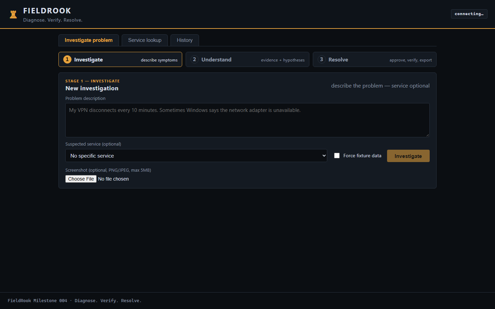
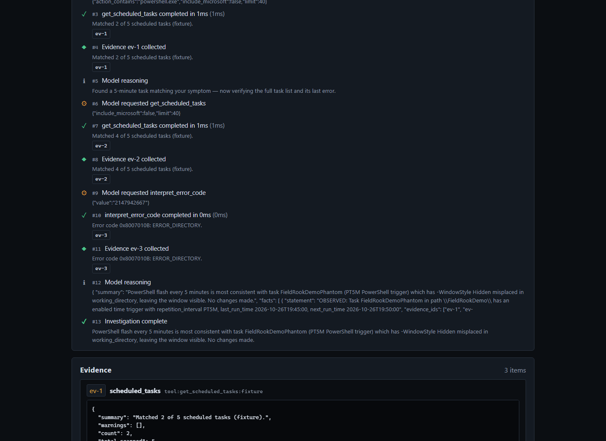
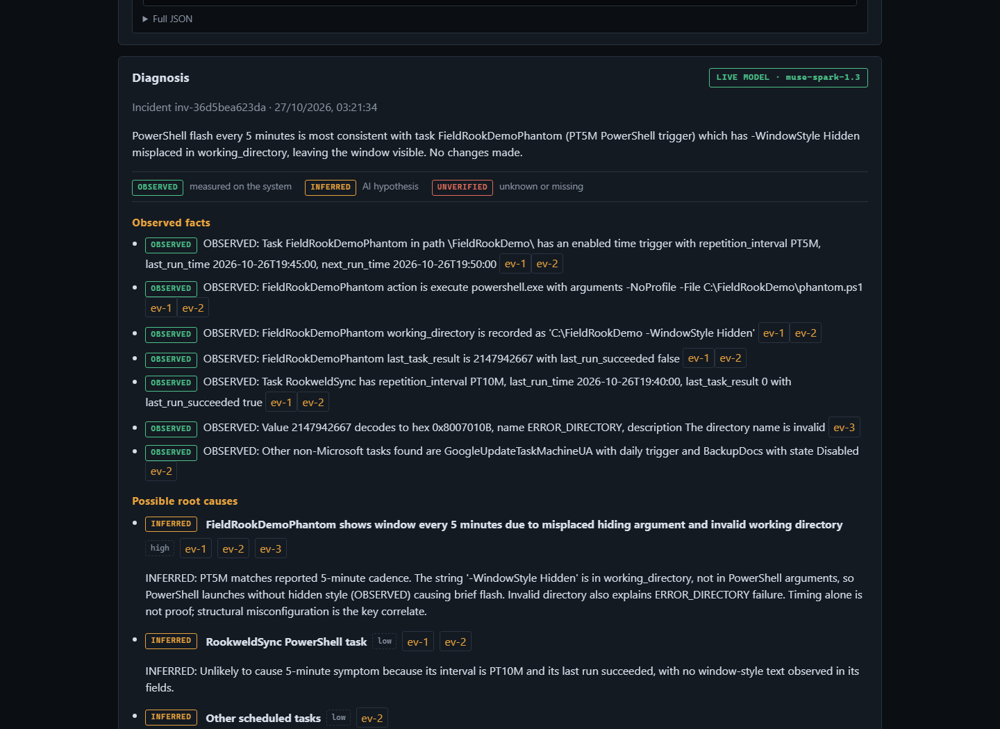

<div align="center">

# 🐦‍⬛ FieldRook
### Diagnose. Verify. Resolve.

**Evidence-driven AI troubleshooting for Windows technicians.**

Turn a reported symptom into an investigation with traceable evidence, technician-controlled recovery, and independently verified outcomes.

[](https://github.com/Rookweld/FieldRook/actions/workflows/validate.yml)
[](LICENSE)


**[Quickstart](#quickstart) · [Demo walkthrough](docs/demo/DEMO_SCRIPT.md) · [How it works](#how-it-works) · [Safety](#safety)**



</div>

## Why FieldRook?

IT diagnosis often means switching between service managers, Windows event logs, scheduled tasks, network tools, and documentation. FieldRook brings the investigation into one local-first workstation. **Meta Muse Spark chooses from bounded diagnostic tools; FieldRook collects evidence and enforces the safety boundary.** The model does not get unrestricted shell access or final authority over whether a fix worked.

| Investigate | Understand | Resolve |
| :-- | :-- | :-- |
| Describe symptoms, optionally provide a screenshot. | Inspect real tool activity, evidence IDs, and clearly labeled uncertainty. | Review a proposed action, approve explicitly, and compare independent before/after checks. |

### A real investigation, not a mockup

The example below uses a **clearly labeled synthetic fixture** based on a real class of recurring PowerShell-window issues. It is not a claim that the same issue is currently active.



<details>
<summary>View evidence-backed diagnosis screenshot</summary>



</details>

## How it works

```text
Technician reports symptoms
          |
          v
Meta Muse Spark plans and requests approved diagnostic tools
          |
          v
Read-only Windows collectors -> timestamped evidence -> cited hypotheses
          |
          v
Optional registered corrective action -> explicit technician approval
          |
          v
Constrained execution -> fresh independent health check -> incident report
```

**Built during the Meta Global AI Developer Hackathon 2026.** See [HACKATHON.md](HACKATHON.md) for the development timeline and [technical highlights](docs/demo/TECHNICAL_HIGHLIGHTS.md) for the implementation boundaries. The only corrective action currently supported targets FieldRook's own demo worker; real Windows diagnostics are read-only.

---

# FieldRook — Diagnose. Verify. Resolve.

Evidence-driven AI troubleshooting assistant for IT technicians. A ROOKWELD
project built for the Meta Global AI Developer Hackathon 2026 (Indie Developer
track, "Build for Your World").

**Milestone 007 — The Active Investigator:** FieldRook now partners through
an ongoing investigation instead of reporting once. Technicians can re-check
any tool-backed observation in place: the identical read-only call re-runs,
the fresh reading is compared against the preserved historical item
(`CHANGED` / `UNCHANGED` / `UNAVAILABLE` with explicit timestamps), and
hypotheses built on the old reading are named for review. The reasoning loop
reuses fresh evidence, links cross-round re-checks automatically, flags
deterministic contradictions between observations, recommends targeted
re-checks, and stops early when new calls add no value. The workspace shows
investigation progress with a tool budget, unresolved questions, suggested
next checks with one-click re-runs, and refresh history per round; reports
export the full evidence lineage. The gauntlet grew to 39 cases and measures
39/39 (31 fixture/tool + 8 capped live `muse-spark-1.3` evaluations); four
field scenarios (mid-investigation state change, network contradiction,
redirected crash hypothesis, honest dead end) validate end to end (see
`backend/eval/REPORT.md`).

**Milestone 006 — The Field Technician:** FieldRook is a usable
troubleshooting workstation. New read-only diagnostics cover application
crashes (Event IDs 1000/1001/1002/1026 with faulting module and exception
codes), process↔service relationships (including a service-name selector),
and DNS with one bounded active control query. A symptom triage planner
routes crash/DNS/VPN/task problems to the smallest relevant tool set, the
workspace shows an incident overview with a leading hypothesis and evidence
coverage, next steps render as evidence-linked runbook cards (why, what to
inspect, what confirms it, read-only vs changes-system, admin hint), and
technicians can record persistent notes. The gauntlet grew to 34 cases and
measures 34/34 (28 fixture/tool + 6 capped live `muse-spark-1.3`
evaluations); field testing on Windows fixed a real uptime-parsing bug (see
`backend/eval/REPORT.md`).

**Milestone 005 — Proof of Value:** approval and execution are now distinct
deliberate steps (approve authorizes, a separate execute runs, expiry returns
the proposal for re-approval), the result panel shows
BEFORE → ACTION → AFTER → VERIFIED OUTCOME from measured states, and a
16-case diagnostic gauntlet measures real quality: 16/16 fixture cases plus
3/3 capped live `muse-spark-1.3` evaluations pass (see
`backend/eval/REPORT.md`). A static read-only replay of a real captured
incident lives in `docs/jury-demo/` for judges without a Windows install.

**Milestone 004 — The Field Demonstration:** the M003 controlled-fix loop is
now a polished three-stage technician workstation — **Investigate → Understand
→ Resolve** — with three reproducible demo scenarios: (A) a phantom PowerShell
scheduled task diagnosed from fixtures, (B) the full live loop of failure,
human approval, fenced recovery, and independent `VERIFIED_RESOLVED`, and (C)
an insufficient-evidence case that reports `UNRESOLVED` honestly instead of
inventing certainty. Corrective actions come only from a predefined backend
registry, require explicit single-use human approval, and are verified by fresh
diagnostics, never by model confidence. Incidents persist in SQLite, export to
Markdown/JSON, and every conclusion stays traceable to evidence framed as
**OBSERVED** (measured), **INFERRED** (AI hypothesis), or **UNVERIFIED**
(unknown or missing).

## Layout

- `backend/` — Python + FastAPI: strict tool registry (services, event logs,
  application crashes, processes, OS, network, scheduled tasks, demo-worker
  health, error codes — all read-only except one bounded active DNS test),
  Meta tool-calling loop with symptom triage, corrective-action subsystem
  (`app/actions/`: registry, policies, approval, executor, verification,
  audit), SQLite persistence, incident export, pytest suite.
- `backend/eval/` — the diagnostic gauntlet: 39 reproducible cases plus the
  evaluation report (`REPORT.md`).
- `demo_worker/` — application-owned background process with a heartbeat health
  check plus a failure simulator for the controlled-fix demonstration.
- `frontend/` — React + TypeScript + Vite: problem workstation (preset
  templates, intake, incident overview, activity timeline, grouped evidence
  cards, runbook assessment, technician notes, follow-ups), Action Center
  (approve/reject, before/after, executions), incident history with export,
  plus the original Milestone 001 service lookup tab. Playwright e2e suite
  under `frontend/tests/e2e/`.
- `scripts/demo/` — demo operations: preflight, worker start, failure
  injection, health checks, and reset (no admin rights needed).
- `docs/demo/` — three-minute demo script, demo-day checklist, technical
  highlights, and judging notes.
- `docs/TOOLS.md` — diagnostic tool reference (14 tools, schemas, bounds).

## Prerequisites

- Windows 10/11 with PowerShell (live diagnostics; fixtures work anywhere)
- Python 3.12+
- Node.js 20+ with pnpm (recommended) or npm

## Quickstart

### 1. Backend

```powershell
cd C:\dev\FieldRook\backend
python -m venv .venv
.\.venv\Scripts\python -m pip install -r requirements.txt
Copy-Item ..\.env.example ..\.env   # optional; set MODEL_API_KEY for live model calls
.\.venv\Scripts\python -m uvicorn app.main:app --host 127.0.0.1 --port 8000
```

### 2. Frontend

```powershell
cd C:\dev\FieldRook\frontend
pnpm install
pnpm run dev
```

(`npm install` / `npm run dev` are an alternative if you prefer npm.)

Open <http://localhost:5173>. The Vite dev server proxies `/api` to the backend.

### 3. Demo operations (Scenario B)

```powershell
cd C:\dev\FieldRook
powershell -ExecutionPolicy Bypass -File scripts/demo/preflight.ps1     # readiness
powershell -ExecutionPolicy Bypass -File scripts/demo/start-worker.ps1  # healthy worker
powershell -ExecutionPolicy Bypass -File scripts/demo/inject-failure.ps1 # inject the fault
powershell -ExecutionPolicy Bypass -File scripts/demo/check-health.ps1  # worker + backend
powershell -ExecutionPolicy Bypass -File scripts/demo/reset-demo.ps1    # healthy again
```

Set `$env:FIELDROOK_PYTHON` to override the interpreter if the venv lives
elsewhere. See `docs/demo/DEMO_SCRIPT.md` for the three-minute run.

### 4. Tests

```powershell
cd C:\dev\FieldRook\backend
.\.venv\Scripts\python -m pytest -q
cd ..\frontend
pnpm run test:e2e   # Playwright: real backend (fixtures, no key) + real UI
```

## Modes

- **Diagnostics:** live PowerShell collection on Windows; deterministic fixtures
  when unavailable, or forced with `FIELDROOK_FIXTURES=always`.
- **Analysis:** live Meta Model API (`muse-spark-1.3`, tool calling + vision)
  when `MODEL_API_KEY` is set; otherwise clearly labeled simulated analysis.
  Simulated output is never presented as a live model call.

## API

| Method | Path | Description |
| ------ | ---- | ----------- |
| GET | `/api/status` | Backend status, platform, active modes |
| GET | `/api/tools` | Read-only diagnostic tool registry |
| GET | `/api/services` | List Windows services (live or fixture) |
| GET | `/api/services/{name}/diagnostics` | Evidence bundle for one service |
| POST | `/api/incidents/analyze` | M001 assessment: `{"service_name": "...", "use_fixtures": null}` |
| POST | `/api/investigations` | Start NL investigation (multipart: `problem`, optional `service_name`, `screenshot` + `share_consent`, `use_fixtures`) |
| GET | `/api/investigations` | Incident history (persisted, `?limit=`) |
| GET | `/api/investigations/{id}` | Current investigation state |
| POST | `/api/investigations/{id}/followup` | Continue: `{"message": "..."}` |
| POST | `/api/investigations/{id}/notes` | Technician note: `{"text": "..."}` (max 2000 chars, persisted, exported) |
| POST | `/api/investigations/{id}/reverify` | Re-run one observation: `{"evidence_id": "ev-2"}` → new item + `changed/unchanged/unavailable` comparison; history preserved |
| GET | `/api/investigations/{id}/export?format=markdown\|json` | Ticket-ready incident report |
| POST | `/api/investigations/{id}/proposals` | Propose a registered action (never executes) |
| POST | `/api/proposals/{id}/approve` | Human approval → single-use token (5 min TTL) |
| POST | `/api/proposals/{id}/reject` | Human rejection → system left unchanged |
| POST | `/api/proposals/{id}/execute` | Run approved action: `{"approval_token": "...", "args": {...}}` |

## Safety

Diagnostics are strictly read-only with one labeled exception: services,
event logs (System/Application), application crashes, processes, OS info,
network state, scheduled task definitions, demo-worker health, and error
codes are only ever read through predefined, schema-validated tools
(bounded budget: 8 initial + 4 per follow-up tool calls, 12 total including re-checks; per-tool
timeouts; truncated results). `test_dns_resolution` is an explicitly labeled ACTIVE
TEST (one A/AAAA query, changes nothing). The model can never send
executable commands, and full process command lines are never collected
(executable path only).

The one corrective capability — `recover_demo_worker` on the
application-owned `demo-worker` — is fenced by: registry-only actions, target
allowlist, schema-validated arguments, live preconditions, explicit human
approval (single-use token, 5-minute TTL, exact-argument binding, invalidated
if the investigation changes), single-flight execution with timeout,
fenced worker-process verification, independent post-action verification
(`VERIFIED_RESOLVED` etc., never overridable by the model), localhost binding,
cross-origin mutation blocking, and a full audit trail persisted in SQLite.
Rejection leaves the system unchanged. Set `FIELDROOK_ACTIONS_ENABLED=0` to
disable all corrective actions while keeping diagnostics.

No arbitrary shell execution, service control, network resets, registry edits,
installations, or privilege escalation exist. Screenshots are validated
(PNG/JPEG, magic bytes, 5MB cap), require explicit sharing consent, are sent to
the Meta API only with that consent, and are never stored by FieldRook.
Approval tokens are stored as hashes only; the database and demo state live in
gitignored local paths (`backend/data/`, `demo_worker/state/`).

## Local-only security notice

FieldRook binds to localhost (`127.0.0.1:8000` backend, `localhost:5173` UI)
and rejects cross-origin browser mutations. Do not expose either service to a
network, do not run the corrective-action endpoints on shared infrastructure,
and never commit a real `.env` containing `MODEL_API_KEY`.
## Known limitations

- One corrective action only (`recover_demo_worker` on the application-owned
  demo worker); the registry is intentionally minimal.
- No per-user authentication; localhost binding is the access boundary.
- Browser end-to-end tests cover key flows via Playwright; live model calls remain separate smoke tests.
- Large investigation histories can approach the 60s model timeout.
- Process `ExecutablePath` reads return empty without elevation (graceful
  degradation, not an error); name-based lookups over many matches
  (e.g. `svchost.exe`) can take ~15s.
- Fixture mirrors are per-tool snapshots, not one consistent machine state;
  live readings are authoritative.
- Model output is advisory: verification outcomes are computed by backend
  diagnostics and can never be overridden by the model.
## License

Copyright 2026 ROOKWELD (Pontus Lindh). Licensed under the Apache License,
Version 2.0 -- see [LICENSE](LICENSE) for the full text.
