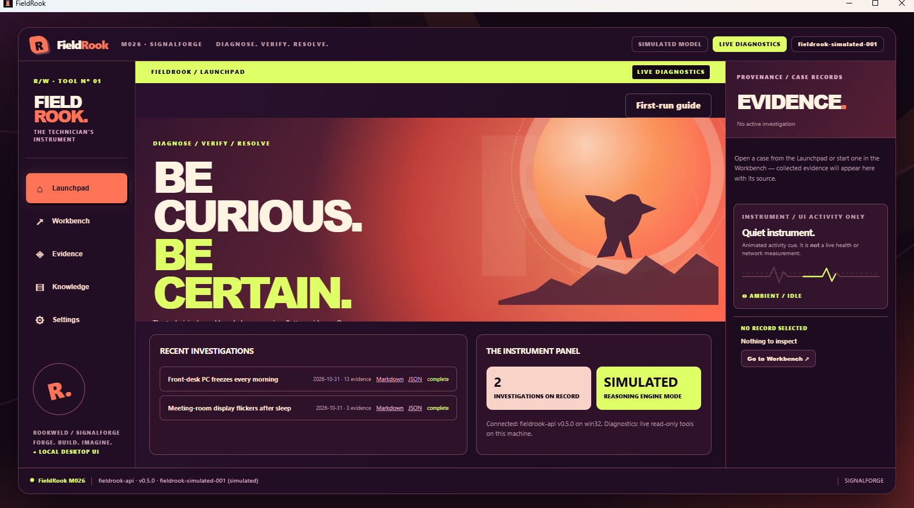
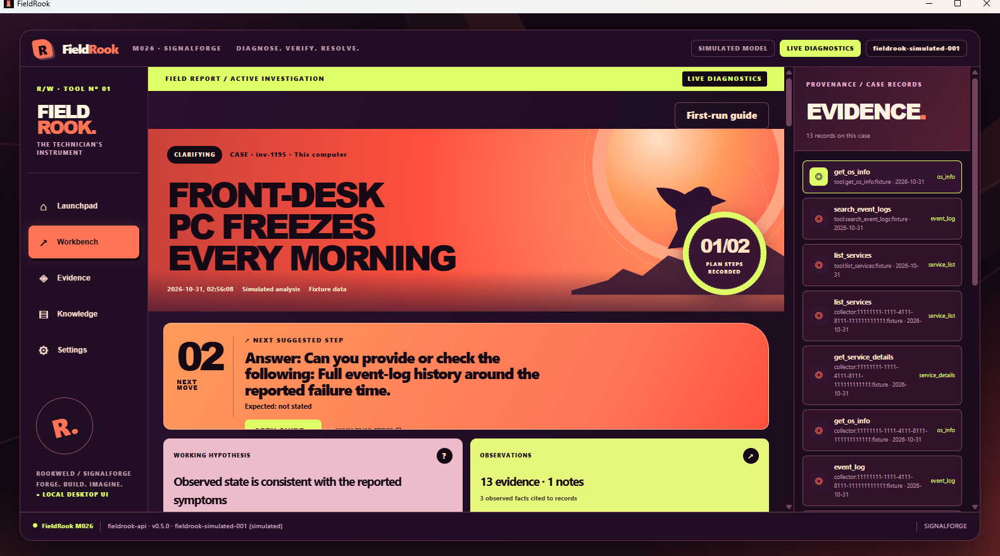
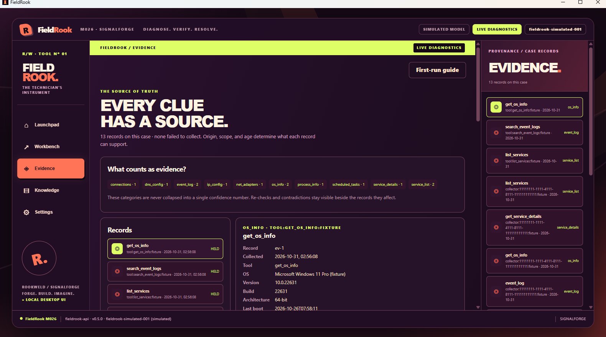
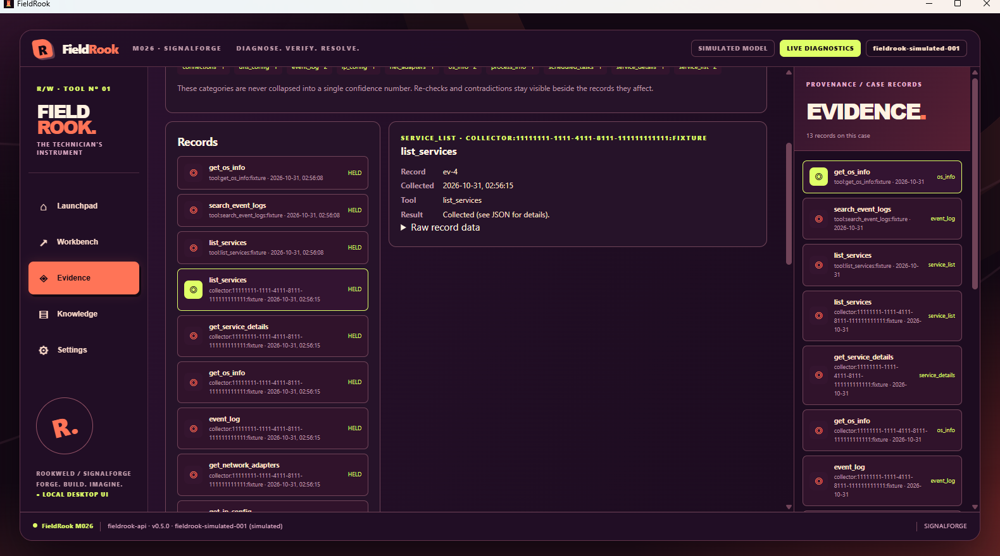
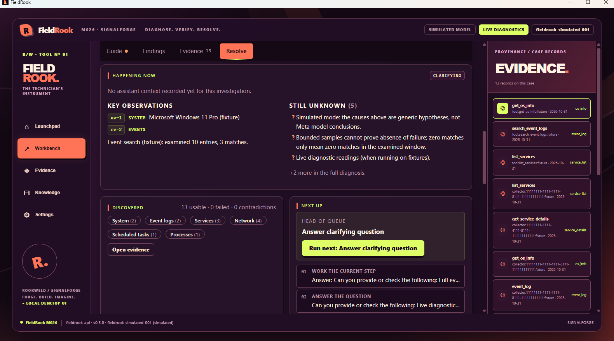
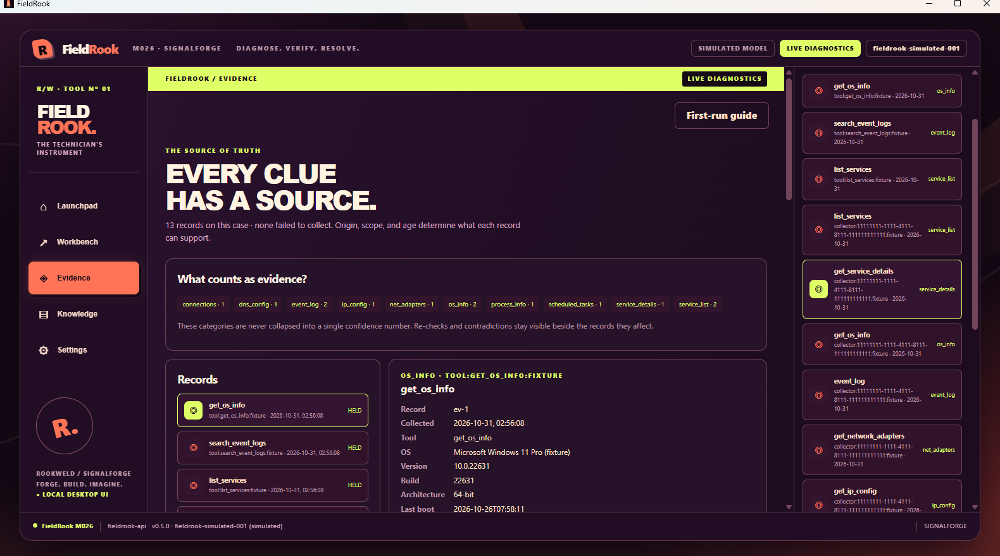
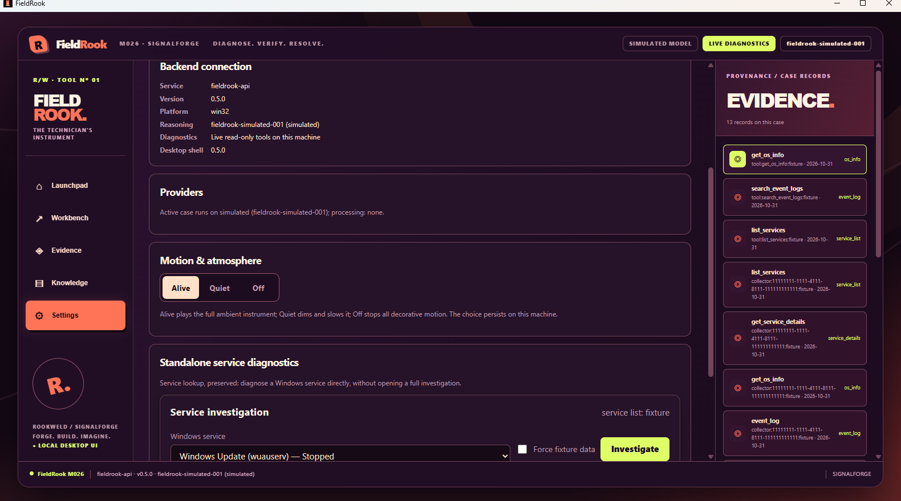
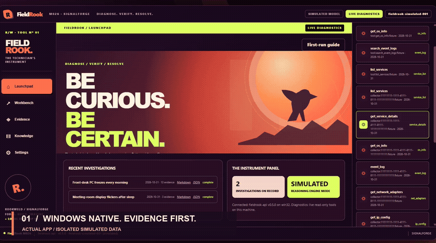

<div align="center">

# FIELDROOK

### DIAGNOSE. VERIFY. RESOLVE.

**LESS GUESSING. MORE EVIDENCE.**

**A native Windows diagnostic workstation for technicians who want evidence, not guesswork.**

Built by **[ROOKWELD](https://rookweld.com)** · Open source · Designed for real investigations

[](LICENSE)

[](https://github.com/Rookweld/FieldRook/releases/tag/v0.6.0-rc.1)


[**Evidence Trials (live demo)**](https://rookweld.github.io/FieldRook/) · [**See the workstation**](#the-workstation) · [**How it works**](#from-symptom-to-evidence) · [**Get started**](#get-started) · [**Safety**](#safety-is-part-of-the-product) · [**Field Kit**](#the-field-kit)



**An actual WPF + WebView2 Windows application. Not a browser tab.**

</div>

---

## Evidence Trials — Operation Prove It

**[Explore the interactive Evidence Trials →](https://rookweld.github.io/FieldRook/)**

Three reproducible **synthetic** investigations expose FieldRook's source-linked evidence, hypotheses, action boundaries and independently measured outcomes: a suspicious five-minute task (**cause unverified**), a simulated worker recovery (**VERIFIED_RESOLVED**), and a reported fix that fresh evidence rejects (**NOT_RESOLVED**). No customer data, real host changes, or live-model performance claims. The [public methodology and export scripts](docs/evidence-trials/README.md) allow independent inspection.

## Built for the moment when "it's not working" is all you have

FieldRook turns an unfamiliar Windows problem into a structured investigation. It helps a technician capture observations, run bounded diagnostics, examine traceable evidence, test competing explanations, and record whether a resolution was *actually verified*.

The AI is an assistant to the technician—not an unrestricted shell, a source of invented facts, or an authority that can silently declare a machine fixed.

<table>
<tr><th>Investigate</th><th>Understand</th><th>Verify</th></tr>
<tr>
<td>Describe the issue and select the affected computer.</td>
<td>Inspect observations, provenance, hypotheses, and the next useful question.</td>
<td>Record what changed, distinguish claims from measurements, and export the case.</td>
</tr>
</table>

## The workstation

### A real desktop app, with a distinct identity

FieldRook 0.5.0 introduces **SIGNALFORGE**: a retro-futuristic instrument-inspired interface, with deep plum surfaces, coral highlights, selective acid-lime signals, and restrained circuit-trace motion.

Its new **native WPF shell** embeds the existing React workstation through WebView2 and manages the packaged local FastAPI server. The usual experience is one Windows window, not a manually launched backend plus a browser tab.



*The SIGNALFORGE Workbench — actual FieldRook 0.5.0 UI capture, not concept art.*

<details>
<summary><strong>More native-app captures — evidence, Collector, resolution, and settings</strong></summary>

#### Examine evidence



#### Import a Collector package



#### Review the resolution queue



#### Inspect the contextual evidence rail



#### Tune the living interface



</details>

### Watch the real Windows app in action

[](docs/assets/m027/fieldrook-v0.5.0-signalforge-trailer.mp4)

**[▶ Watch the 33-second SIGNALFORGE release trailer (MP4)](docs/assets/m027/fieldrook-v0.5.0-signalforge-trailer.mp4)** · [Download v0.5.0](https://github.com/Rookweld/FieldRook/releases/tag/v0.5.0)

> **Real-product footage.** The trailer is edited from an OS-level capture of the **shipped v0.5.0 native Windows application**, running isolated simulated demo investigations. Slow camera pushes, typography, transitions, and an original electronic sound bed were added in post-production; the application's UI and case data were **not fabricated or altered**. Decorative interface motion is not telemetry.

The background motion is deliberately subtle. The interface offers **Alive**, **Quiet**, and **Off** preferences and supports reduced-motion behavior. Decorative activity is not presented as a real hardware measurement.

## From symptom to evidence

```text
Technician describes an issue
          │
          ▼
Choose target: this PC / another PC / not yet known
          │
          ▼
Run approved local diagnostics or import a Collector package
          │
          ▼
Timestamped evidence + provenance + visible uncertainty
          │
          ▼
Review hypotheses and the next useful check
          │
          ▼
Technician observes, confirms, or supplies new evidence
          │
          ▼
Document outcomes and export a case report
```

### What works today

| Capability | What it does |
| :--- | :--- |
| **Native Windows workstation** | Opens in its own WPF/WebView2 window with the SIGNALFORGE interface. |
| **Guided investigations** | Keeps the problem, current questions, evidence, and investigation history together. |
| **Windows diagnostics** | Uses registered, bounded diagnostics with explicit target and tool boundaries. |
| **Portable Collector** | Gathers read-only evidence on a Windows computer and exports a versioned, hash-verified ZIP for import. |
| **Evidence and provenance** | Shows where observations came from and distinguishes collected measurements from user reports and model interpretations. |
| **Knowledge support** | Retrieves relevant technical references as quoted context with citations; irrelevant matches are filtered conservatively. |
| **AI provider choice** | Supports optional local-model inference and configured cloud inference; simulated operation remains labeled. |
| **Technician-controlled actions** | Keeps proposals, approvals, execution, and verification separate. The only implemented corrective execution targets FieldRook's own demo worker. |
| **Case persistence and export** | Reopen investigations and produce technician-readable case reports. |
| **Motion preferences** | Tune the ambient UI between Alive, Quiet, and Off. |

**Important:** An imported Collector package does *not* give FieldRook remote command execution. Host-local measurements cannot be silently substituted for a different machine, and a remote reading cannot be rechecked against the operator's own PC.

## The portable Collector

The Collector is a separate Windows executable. It is designed to run on an affected computer without requiring a Python installation, gather selected read-only diagnostics with consent, and create a package that FieldRook can validate and import.

```text
Affected Windows PC                           Technician's FieldRook
┌─────────────────────┐                        ┌─────────────────────┐
│ FieldRook Collector │─── evidence ZIP ────▶ │  Import + validate  │
│  read-only capture  │                        │  investigate        │
└─────────────────────┘                        └─────────────────────┘
```

Collection is not silently uploaded. Some elevated collection categories have not yet been validated in the release candidate; permissions and unavailable measurements must be reported honestly.

## Get started

### Latest Windows desktop pre-release — v0.6.0-rc.1 (published November 3, 2026)

The newest published Windows desktop package is **[v0.6.0-rc.1](https://github.com/Rookweld/FieldRook/releases/tag/v0.6.0-rc.1)**. It includes the functional **Field Kit dock, Evidence Lens, and Network Lab**. This is a **pre-release**, not a stable or independently certified build.

- [FieldRook-0.6.0-rc.1.zip](https://github.com/Rookweld/FieldRook/releases/download/v0.6.0-rc.1/FieldRook-0.6.0-rc.1.zip) — portable Windows desktop app; extract the full archive and run `FieldRook.exe`.
- [SHA256SUMS.txt](https://github.com/Rookweld/FieldRook/releases/download/v0.6.0-rc.1/SHA256SUMS.txt) — published checksums.
- [BOM.txt](https://github.com/Rookweld/FieldRook/releases/download/v0.6.0-rc.1/BOM.txt) — build provenance.

Keep the extracted application files together. On first launch, configure the desired inference mode. **Windows 10/11 x64 and WebView2 Runtime are required.** The binaries are unsigned; verify the published checksums before running. No model is bundled by default, and offline evidence workflows do not depend on paid cloud inference.

The v0.6.0-rc.1 release **does not include a new, separately packaged Collector download**. The earlier Collector build is available with v0.5.0 below; cross-version Collector compatibility has not been certified. Do not assume the older Collector is validated with v0.6.0-rc.1.

For details, see the [v0.6.0-rc.1 release notes](RELEASE_NOTES_v0.6.0-rc.1.md) and [provider configuration](docs/PROVIDERS.md).

### Previous desktop and Collector pre-release — v0.5.0

The earlier [v0.5.0 release](https://github.com/Rookweld/FieldRook/releases/tag/v0.5.0) is retained for reference and includes two separately published packages:

- [FieldRook-0.5.0.zip](https://github.com/Rookweld/FieldRook/releases/download/v0.5.0/FieldRook-0.5.0.zip) — previous portable desktop app.
- [FieldRook-Collector-0.5.0.zip](https://github.com/Rookweld/FieldRook/releases/download/v0.5.0/FieldRook-Collector-0.5.0.zip) — portable read-only Collector.
- [SHA256SUMS-v0.5.0.txt](https://github.com/Rookweld/FieldRook/releases/download/v0.5.0/SHA256SUMS-v0.5.0.txt) — release checksums.

**v0.5.0 does not contain the Field Kit instruments** introduced in v0.6.0-rc.1. Historical native-delivery notes are in [M026](docs/M026_DELIVERY.md).

### Building from source

This repository contains the Python/FastAPI backend, React/TypeScript frontend, native Windows shell, and packaging scripts. Development requires the corresponding build tools; **end users of the packaged Desktop do not need Python or Node.js installed separately**.

From a Windows development checkout with Python, Node.js/pnpm, and .NET 10 SDK, follow [the desktop build documentation](packaging/desktop/README-SHELL.md) and [the M026 delivery manifest](docs/M026_DELIVERY.md). The native shell and backend are packaged separately, then assembled into the complete distribution. Do not confuse the older browser-based development launcher with the packaged native Windows application.

## Safety is part of the product

FieldRook deliberately makes certain operations harder to do by accident.

- **Read-only by default.** Windows diagnostics use registered capabilities and bounded inputs, not arbitrary model-authored PowerShell.
- **Target-aware evidence.** Collector imports are tied to the affected computer; mismatched identities are not silently mixed.
- **Human control.** An AI suggestion is not permission to execute it. Corrective actions require explicit approval and a registered execution path.
- **Measured verification.** An intervention being attempted or reported does not mean the problem was resolved.
- **Local-first processing.** The packaged service binds to loopback and uses application-owned local storage. Cloud-provider use requires deliberate configuration and consent.
- **Provenance and privacy.** Collector archives are integrity-checked, and diagnostic data is not automatically transmitted elsewhere.
- **Separation of fact and inference.** Model explanations and confidence language never replace measured evidence.

Security documentation: [FORGE privacy](docs/FORGE_PRIVACY.md) · [Tool boundaries](docs/TOOLS.md) · [Technical highlights](docs/demo/TECHNICAL_HIGHLIGHTS.md)

## Inside FieldRook

| Layer | Implementation |
| :--- | :--- |
| Desktop host | .NET WPF + Microsoft Edge WebView2 |
| Frontend | React + TypeScript + Vite, SIGNALFORGE design system |
| Local API and investigation engine | Python + FastAPI |
| Case persistence | SQLite in per-user application data |
| Windows evidence | Allowlisted diagnostic toolpacks and portable Collector |
| Inference | Optional configured local or cloud providers; no unrestricted shell authority |
| Validation | Pytest, Playwright, .NET tests, diagnostic gauntlet, frozen-app smoke tests |

FieldRook was developed as part of the **[Meta Global AI Developer Hackathon 2026](https://dev.meta.ai/events/global-hackathon)**. This project is independent; participation is not an endorsement by Meta.

## Validation and known limits

For the historical **v0.5.0 / M026.1** release-candidate verification (plus green GitHub Actions on the merged source), the records show:

| Gate | Reported result |
| :--- | :--- |
| Backend | 687 passed, 4 environment-dependent skips |
| Playwright end-to-end | 47 / 47 passed |
| .NET tests | 66 / 66 passed |
| Diagnostic gauntlet | 38 / 38 passed |
| Native packaged journey | Investigation, Collector import, export, and persistence exercised |
| Security probes | 11 / 11 passed |

These are **local release-candidate validation results**, not a claim that every user environment, Windows machine, AI provider, or troubleshooting problem has been certified.

**Still to validate:** unsigned-binary reputation and antivirus behavior across vendors; Windows machines without WebView2; multi-machine field trials; upgrade-over-existing installation; selected elevated Collector categories; lower-end CPU-only local-model responsiveness; some performance combinations on other GPUs.

## The Field Kit

The right-hand dock is now a modular, context-aware technician toolbox. Shipped in this source tree as evidence-backed instruments with bounded diagnostics and clear local-versus-remote behavior:

- **Evidence Lens** -- deterministic before/after record compare over persisted evidence, with contradiction citations and export linkage.
- **Network Lab** -- read-only networking instrument (adapters, addresses, DNS config, resolution test) with consented re-checks and a remote-target guard.
- **Field Kit dock** -- instrument framework with pins, keyboard access, and narrow-overlay support.

These instruments are **included in the published v0.6.0-rc.1 desktop pre-release**, and are covered by the demo scenario in [M028_THREE_MINUTE_DEMO.md](docs/demo/M028_THREE_MINUTE_DEMO.md). They are **not included in the earlier v0.5.0 binaries**. The remaining modules (**Process Watch, Event Decoder, Command Deck, Field Notes**) are still design-prototype concepts, not shipped features.

## Project and development history

- [M026 native desktop delivery](docs/M026_DELIVERY.md)
- [Hackathon build log](HACKATHON.md)
- [Provider documentation](docs/PROVIDERS.md)
- [Diagnostic tool reference](docs/TOOLS.md)
- [Security and privacy](docs/FORGE_PRIVACY.md)
- [License](LICENSE)

---

<div align="center">

### LESS GUESSING. MORE EVIDENCE.

**FIELDROOK** · **DIAGNOSE. VERIFY. RESOLVE.**

Made at **ROOKWELD** — *FORGE. BUILD. IMAGINE.*

</div>
