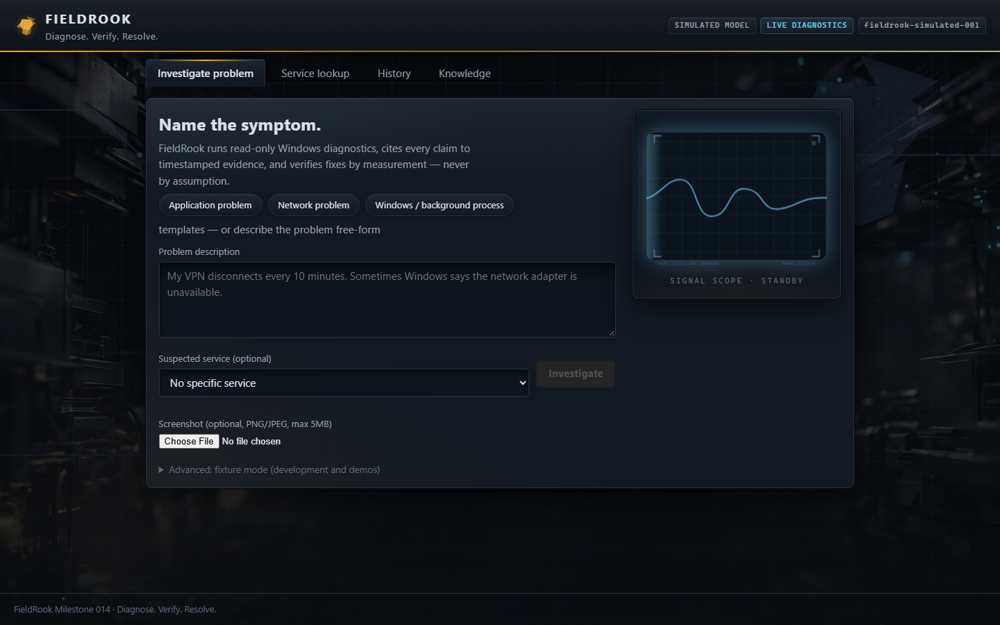
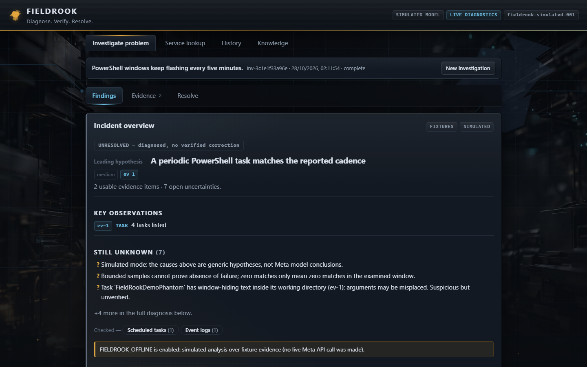
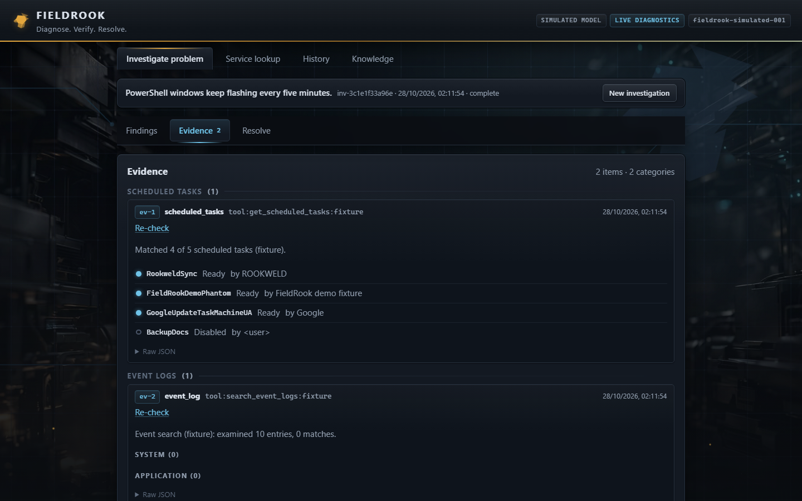
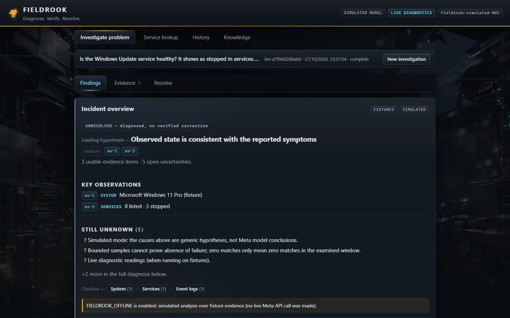
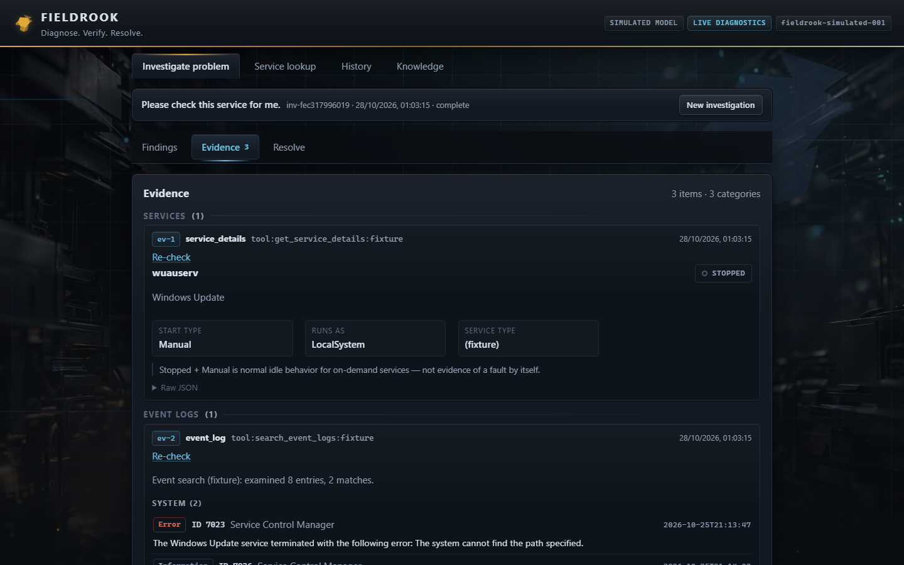
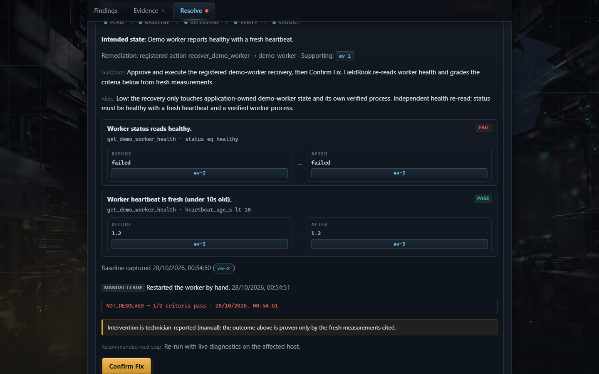

<div align="center">

# 🐦‍⬛ FieldRook
### Diagnose. Verify. Resolve.

**Evidence-driven AI troubleshooting for Windows technicians.**

Turn a reported symptom into an investigation with traceable evidence, technician-controlled recovery, and independently verified outcomes.

[](https://github.com/Rookweld/FieldRook/actions/workflows/validate.yml)
[](LICENSE)


**[Quickstart](#quickstart) · [Demo walkthrough](docs/demo/DEMO_SCRIPT.md) · [How it works](#how-it-works) · [Safety](#safety)**



</div>

## Why FieldRook?

IT diagnosis often means switching between service managers, Windows event logs, scheduled tasks, network tools, and documentation. FieldRook brings the investigation into one local-first workstation. **Meta Muse Spark chooses from bounded diagnostic tools; FieldRook collects evidence and enforces the safety boundary.** The model does not get unrestricted shell access or final authority over whether a fix worked.

| Investigate | Understand | Resolve |
| :-- | :-- | :-- |
| Describe symptoms, optionally provide a screenshot. | Inspect real tool activity, evidence IDs, and clearly labeled uncertainty. | Review a proposed action, approve explicitly, and compare independent before/after checks. |

### A real investigation, not a mockup

The example below uses a **clearly labeled synthetic fixture** based on a real class of recurring PowerShell-window issues. It is not a claim that the same issue is currently active.



<details>
<summary>View evidence-backed diagnosis screenshot</summary>



</details>

## How it works

```text
Technician reports symptoms
          |
          v
Meta Muse Spark plans and requests approved diagnostic tools
          |
          v
Read-only Windows collectors -> timestamped evidence -> cited hypotheses
          |
          v
Optional registered corrective action -> explicit technician approval
          |
          v
Constrained execution -> fresh independent health check -> incident report
```

**Built during the Meta Global AI Developer Hackathon 2026.** See [HACKATHON.md](HACKATHON.md) for the development timeline and [technical highlights](docs/demo/TECHNICAL_HIGHLIGHTS.md) for the implementation boundaries. The only corrective action currently supported targets FieldRook's own demo worker; real Windows diagnostics are read-only.


## What is available today?

- **Investigate:** describe a symptom and collect targeted read-only Windows diagnostics for applications, services, events, network, processes and scheduled tasks.
- **Findings:** read the investigation story — key observations, what remains unknown, what was checked — then the cited diagnosis, uncertainties, and historical matches.
- **Evidence:** inspect category-specific visual diagnostics (services, network, crashes, event logs, tasks) with provenance and warnings; raw JSON stays one click away; re-check any reading without losing history.
- **Resolve:** prepare measurable repair plans, require explicit technician approval for registered actions, then independently check the outcome. Only the application-owned demo worker has an implemented corrective action.
- **Remember:** reopen investigations, add technician notes, and compare them with previously saved resolutions (no automatic reuse of old fixes).

**Current stage:** M015 living investigation. Findings became a visual story (key observations, open uncertainties, checked categories), evidence gained category-specific diagnostic components, the timeline became a round-grouped rail, Resolve grew a guided stepper with criterion cards, and motion now follows the data — see the [visual audit](docs/audit/M015_VISUAL.md) and the [product tour video](docs/assets/fieldrook-m015-tour.webm). Backend behavior is unchanged since the M011 live pilot: nine genuine Windows/live-model operations with valid evidence references, plus the fixture-based [gauntlet report](backend/eval/REPORT.md). See the [first-run guide](docs/FIRST_RUN.md), [manual acceptance checklist](docs/ACCEPTANCE.md), and [full milestone log](HACKATHON.md).



<details>
<summary>View Evidence and Resolve screenshots</summary>





</details>

> **Operator note:** when updating the source while a local backend is still running, restart the Python API server too. An older backend process may return an incompatible response to a newer frontend. The UI now surfaces this mismatch instead of crashing.


## Layout

- `backend/` — Python + FastAPI: strict tool registry (services, event logs,
  application crashes, processes, OS, network, scheduled tasks, demo-worker
  health, error codes — all read-only except one bounded active DNS test),
  Meta tool-calling loop with symptom triage, corrective-action subsystem
  (`app/actions/`: registry, policies, approval, executor, verification,
  audit), SQLite persistence, incident export, pytest suite.
- `backend/eval/` — the diagnostic gauntlet: 47 reproducible cases plus the
  evaluation report (`REPORT.md`).
- `demo_worker/` — application-owned background process with a heartbeat health
  check plus a failure simulator for the controlled-fix demonstration.
- `frontend/` — React + TypeScript + Vite: problem workstation (preset
  templates, intake, result header with one next action, Findings / Evidence
  / Resolve views, evidence summaries with on-demand JSON, runbook assessment,
  technician notes, follow-ups), Action Center (approve/reject, before/after,
  executions), incident history with export, plus the original Milestone 001
  service lookup tab. Playwright e2e suite under `frontend/tests/e2e/`.
- `scripts/demo/` — demo operations: preflight, worker start, failure
  injection, health checks, and reset (no admin rights needed).
- `docs/demo/` — three-minute demo script, demo-day checklist, technical
  highlights, and judging notes.
- `docs/TOOLS.md` — diagnostic tool reference (14 tools, schemas, bounds).

## Prerequisites

- Windows 10/11 with PowerShell (live diagnostics; fixtures work anywhere)
- Python 3.12+
- Node.js 20+ with pnpm (recommended) or npm

## Quickstart

### 1. Backend

```powershell
cd C:\dev\FieldRook\backend
python -m venv .venv
.\.venv\Scripts\python -m pip install -r requirements.txt
Copy-Item ..\.env.example ..\.env   # optional; set MODEL_API_KEY for live model calls
.\.venv\Scripts\python -m uvicorn app.main:app --host 127.0.0.1 --port 8000
```

### 2. Frontend

```powershell
cd C:\dev\FieldRook\frontend
pnpm install
pnpm run dev
```

(`npm install` / `npm run dev` are an alternative if you prefer npm.)

Open <http://localhost:5173>. The Vite dev server proxies `/api` to the backend.

### 3. Demo operations (Scenario B)

```powershell
cd C:\dev\FieldRook
powershell -ExecutionPolicy Bypass -File scripts/demo/preflight.ps1     # readiness
powershell -ExecutionPolicy Bypass -File scripts/demo/start-worker.ps1  # healthy worker
powershell -ExecutionPolicy Bypass -File scripts/demo/inject-failure.ps1 # inject the fault
powershell -ExecutionPolicy Bypass -File scripts/demo/check-health.ps1  # worker + backend
powershell -ExecutionPolicy Bypass -File scripts/demo/reset-demo.ps1    # healthy again
```

Set `$env:FIELDROOK_PYTHON` to override the interpreter if the venv lives
elsewhere. See `docs/demo/DEMO_SCRIPT.md` for the three-minute run.

### 4. Tests

```powershell
cd C:\dev\FieldRook\backend
.\.venv\Scripts\python -m pytest -q
cd ..\frontend
pnpm run test:e2e   # Playwright: real backend (fixtures, no key) + real UI
```

## Modes

- **Diagnostics:** live PowerShell collection on Windows; deterministic fixtures
  when unavailable, or forced with `FIELDROOK_FIXTURES=always`.
- **Analysis:** live Meta Model API (`muse-spark-1.3`, tool calling + vision)
  when `MODEL_API_KEY` is set; otherwise clearly labeled simulated analysis.
  Simulated output is never presented as a live model call.

## API

| Method | Path | Description |
| ------ | ---- | ----------- |
| GET | `/api/status` | Backend status, platform, active modes |
| GET | `/api/tools` | Read-only diagnostic tool registry |
| GET | `/api/services` | List Windows services (live or fixture) |
| GET | `/api/services/{name}/diagnostics` | Evidence bundle for one service |
| POST | `/api/incidents/analyze` | M001 assessment: `{"service_name": "...", "use_fixtures": null}` |
| POST | `/api/investigations` | Start NL investigation (multipart: `problem`, optional `service_name`, `screenshot` + `share_consent`, `use_fixtures`) |
| GET | `/api/investigations` | Incident history (persisted, `?limit=`) |
| GET | `/api/investigations/{id}` | Current investigation state |
| POST | `/api/investigations/{id}/followup` | Continue: `{"message": "..."}` |
| POST | `/api/investigations/{id}/notes` | Technician note: `{"text": "..."}` (max 2000 chars, persisted, exported) |
| POST | `/api/investigations/{id}/reverify` | Re-run one observation: `{"evidence_id": "ev-2"}` → new item + `changed/unchanged/unavailable` comparison; history preserved |
| GET | `/api/plans/template?action_id=...` | Suggested measurable criteria for a registered action |
| POST | `/api/investigations/{id}/plans` | Draft a resolution plan (evidence, intended state, criteria, remediation) |
| POST | `/api/plans/{id}/baseline` | Capture pre-fix measurements (rejects unmeasurable criteria) |
| POST | `/api/plans/{id}/interventions/manual` | Record a manual fix (claim only, never proof) |
| POST | `/api/plans/{id}/interventions/link-execution` | Link an authorized execution |
| POST | `/api/plans/{id}/verify` | Confirm Fix: re-measure and grade `VERIFIED_RESOLVED` / `NOT_RESOLVED` / `INCONCLUSIVE` |
| POST | `/api/investigations/{id}/knowledge` | Remember an incident (redacted snapshot; merges exact repeats) |
| GET | `/api/knowledge?q=&category=&outcome=` | Search the local library |
| GET/DELETE | `/api/knowledge/{entry}` | Inspect or delete one entry |
| GET | `/api/knowledge/{entry}/export?format=` | Export a single entry (no leakage) |
| GET | `/api/investigations/{id}/knowledge/matches` | Similar incidents with signals + differences |
| POST | `/api/investigations/{id}/knowledge/{entry}/recheck` | Re-run verified criteria: `CONFIRMED` / `REGRESSION` / `INCONCLUSIVE` |
| GET | `/api/investigations/{id}/export?format=markdown\|json` | Ticket-ready incident report |
| POST | `/api/investigations/{id}/proposals` | Propose a registered action (never executes) |
| POST | `/api/proposals/{id}/approve` | Human approval → single-use token (5 min TTL) |
| POST | `/api/proposals/{id}/reject` | Human rejection → system left unchanged |
| POST | `/api/proposals/{id}/execute` | Run approved action: `{"approval_token": "...", "args": {...}}` |

## Safety

Diagnostics are strictly read-only with one labeled exception: services,
event logs (System/Application), application crashes, processes, OS info,
network state, scheduled task definitions, demo-worker health, and error
codes are only ever read through predefined, schema-validated tools
(bounded budget: 8 initial + 4 per follow-up tool calls, 12 total including re-checks; per-tool
timeouts; truncated results). `test_dns_resolution` is an explicitly labeled ACTIVE
TEST (one A/AAAA query, changes nothing). The model can never send
executable commands, and full process command lines are never collected
(executable path only).

The one corrective capability — `recover_demo_worker` on the
application-owned `demo-worker` — is fenced by: registry-only actions, target
allowlist, schema-validated arguments, live preconditions, explicit human
approval (single-use token, 5-minute TTL, exact-argument binding, invalidated
if the investigation changes), single-flight execution with timeout,
fenced worker-process verification, independent post-action verification
(`VERIFIED_RESOLVED` etc., never overridable by the model), localhost binding,
cross-origin mutation blocking, and a full audit trail persisted in SQLite.
Rejection leaves the system unchanged. Set `FIELDROOK_ACTIONS_ENABLED=0` to
disable all corrective actions while keeping diagnostics.

No arbitrary shell execution, service control, network resets, registry edits,
installations, or privilege escalation exist. Screenshots are validated
(PNG/JPEG, magic bytes, 5MB cap), require explicit sharing consent, are sent to
the Meta API only with that consent, and are never stored by FieldRook.
Approval tokens are stored as hashes only; the database and demo state live in
gitignored local paths (`backend/data/`, `demo_worker/state/`).

## Local-only security notice

FieldRook binds to localhost (`127.0.0.1:8000` backend, `localhost:5173` UI)
and rejects cross-origin browser mutations. Do not expose either service to a
network, do not run the corrective-action endpoints on shared infrastructure,
and never commit a real `.env` containing `MODEL_API_KEY`.
## Known limitations

- One corrective action only (`recover_demo_worker` on the application-owned
  demo worker); the registry is intentionally minimal.
- No per-user authentication; localhost binding is the access boundary.
- Browser end-to-end tests cover key flows via Playwright; live model calls remain separate smoke tests.
- Large investigation histories can approach the 60s model timeout.
- Process `ExecutablePath` reads return empty without elevation (graceful
  degradation, not an error); name-based lookups over many matches
  (e.g. `svchost.exe`) can take ~15s.
- Fixture mirrors are per-tool snapshots, not one consistent machine state;
  live readings are authoritative.
- Model output is advisory: verification outcomes are computed by backend
  diagnostics and can never be overridden by the model.
## License

Copyright 2026 ROOKWELD (Pontus Lindh). Licensed under the Apache License,
Version 2.0 -- see [LICENSE](LICENSE) for the full text.
